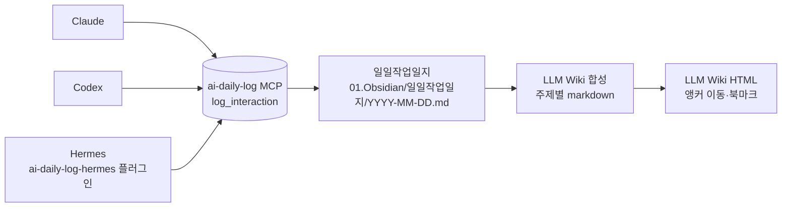
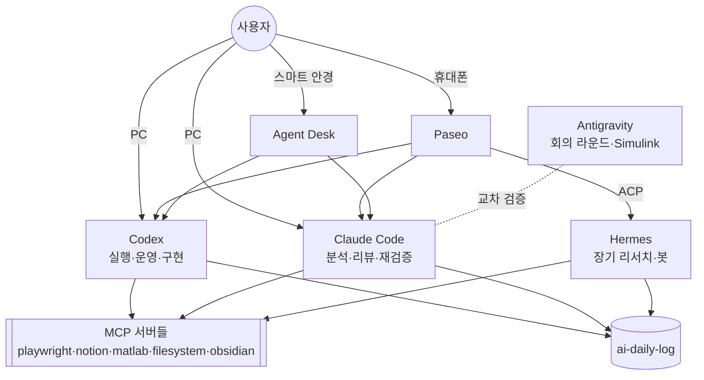

# AI Lab — AI 오픈소스·도구 인벤토리와 활용법

> 기준일: 2026-11-05. 원본은 로컬 `D:\VSCode_Workspace\02.AI_laboratory`, `D:\MYDrive\19_AI_LAB`, `D:\MYDrive\20_CommonWork\03_AI도구자동화`이고, 이 문서는 그 Google Drive 미러를 **읽기 전용으로** 조사해 정리했습니다.
> 공개 저장소이므로 토큰·계정·개인 경로는 싣지 않았습니다. 사용자 폴더는 `%USERPROFILE%`로 표기합니다.

---

## 1. Lab 폴더 구조

```text
D:\VSCode_Workspace\02.AI_laboratory\          ← 에이전트별 작업 Lab
├─ 00_Claude_Lab_V01        Claude Code 작업물
├─ 10_Codex_Lab_V01         Codex 작업물 (~2026-09-15)
├─ 10_Codex_Lab_V02         Codex 작업물 (2026-09-15~, 월별 폴더)
│   └─ 2026-10\2026-10-14_Tools_Ollama_Cleanup_Codex\ ...
├─ 20_Antigravity_Lab_V01   Google Antigravity 작업물
├─ 30_Hermes_Lab_V01        Hermes Agent 작업물 (00_inbox / 01_projects / 02_shared / 03_playground / 90_archive)
├─ 40_Paseo_Lab_V01         Paseo 작업물 (paseo.json 서비스 정의)
└─ Version_readme.txt       폴더별 용도 정의

D:\MYDrive\19_AI_LAB\                           ← 단일 목적 유틸·분석 프로젝트
├─ pc-compromise-analysis-261022   REA 사례 (→ rea-reverse-engineering-analysis.md)
├─ matlab-session-cleanup          Codex notify 훅 + MATLAB 세션 정리
├─ mydrive-storage-agent           조회 전용 용량 인벤토리 (uv 실행)
├─ ai-firewall-helper              방화벽 규칙 설계 (적용 전 승인 대기)
└─ blackwell-/obc-ldc-silicon-to-scale   three.js 단일 HTML 시각화

D:\MYDrive\20_CommonWork\03_AI도구자동화\
├─ AI_Lab                          이 저장소(github.com/hdh0980/AI_Lab)의 로컬 클론
├─ ChatGPT_PC_GitHub_MCP           ChatGPT ↔ PC 파일·GitHub MCP 브리지
└─ 261029_AI_Component_Selection_Agent   부품선정 에이전트 제안(구현 전)
```

**이름 규칙**

| 대상 | 규칙 | 예 |
|---|---|---|
| 에이전트 Lab | `NN_Tool_Lab_Vxx` | `30_Hermes_Lab_V01` |
| 작업 폴더 | `YYYY-MM-DD_주제_에이전트` | `2026-10-14_Tools_Ollama_Cleanup_Codex` |
| Hermes 프로젝트 | `01_projects/YYYYMMDD_topic_slug/` | `20260711_alirezarezvani_claude_skills_research` |
| 20_CommonWork 프로젝트 | `YYMMDD_ProjectName_간략요약` + `워크플로우_YYMMDD_Vn.md` | `워크플로우_260930_V1.md` |

---

## 2. 인벤토리 한눈에 보기

구분: **OSS** = 공개 오픈소스 / **자체** = 직접 만든 도구 / **상용** = 오픈소스 아님(비교용)

| # | 도구 | 구분 | 역할 | 위치 |
|---|---|---|---|---|
| 1 | **Hermes Agent** (Nous Research) | OSS (MIT, 문서 기재) | 장기 리서치·프로필·봇 게이트웨이 에이전트 | `30_Hermes_Lab_V01` |
| 2 | **Paseo** (getpaseo/paseo) | OSS | 휴대폰에서 PC의 Codex·Claude·Hermes CLI를 원격 조작하는 데몬 | `40_Paseo_Lab_V01` |
| 3 | **Ollama** + 로컬 모델 (TranslateGemma, BGE-M3, faster-whisper, PaddleOCR) | OSS | 로컬 추론·번역·임베딩·STT·OCR | `Tools`, Hermes `local-my-brain-model-selection` |
| 4 | **MCP SDK** (Python `mcp`, TypeScript `@modelcontextprotocol/sdk`) | OSS | 자체 MCP 서버·앱의 기반 | `ChatGPT_PC_GitHub_MCP`, `agent-desk/server` |
| 5 | **MCP 서버 묶음** — Playwright, Notion, MATLAB MCP Server, filesystem, obsidian, drawio, mermaid, fetch, brave-search, Excalidraw | OSS(대부분) | 브라우저·문서·MATLAB·파일 도구를 에이전트에 연결 | Claude / Codex / Hermes 설정 |
| 6 | **Codex CLI / Desktop** (OpenAI) | OSS(CLI) | 실행·시스템 운영·도구 구현 담당 | `10_Codex_Lab_V01/V02` |
| 7 | **alirezarezvani/claude-skills** | OSS | 외부 스킬 라이브러리 (도입 전 평가 대상) | Hermes 프로젝트 폴더 |
| 8 | **LLM Wiki 패턴** (Karpathy) + Obsidian | OSS 패턴 | RAG 없이 markdown 위키를 LLM이 직접 읽고 쓰는 지식베이스 | `01.Obsidian`, `Tools\llm_wiki_*` |
| 9 | **REA 도구 스택** — capstone, dnfile, dncil, Binary Refinery 등 | OSS | 악성코드 정적 리버싱 | → [REA 문서](rea-reverse-engineering-analysis.md) |
| 10 | three.js r170 | OSS | 단일 HTML 3D 시각화 | `19_AI_LAB/*-silicon-to-scale` |
| A | ai-daily-log MCP / harness | 자체 | 모든 에이전트 대화를 일일작업일지에 기록 | `Tools\ai_daily_log_harness` |
| B | ChatGPT_PC_GitHub_MCP | 자체 (MCP SDK + OpenAI Secure MCP Tunnel) | ChatGPT에서 PC 파일 읽기·쓰기, GitHub 브랜치 커밋 | `03_AI도구자동화` |
| C | Agent Desk | 자체 (MIT 표기) | 스마트 안경·휴대폰에서 Codex/Claude 작업 승인·지시 | `12_EvenG2/apps/agent-desk` |
| D | AI Agent Framework (`select_agent_pack.py`) | 자체 | 에이전트 분류·활성화·검증 5층 구조 | `10_Codex_Lab_V01/AI_Agent_Lab` |
| — | Claude Code, Google Antigravity | 상용 | 분석·리뷰 / 회의 라운드·Simulink | `00_`, `20_` Lab |

---

## 3. 도구별 구성과 활용 예시

### 3.1 Hermes Agent — 장기 리서치·멀티 프로필

**구성 (비밀값 제외)**

| 항목 | 값 |
|---|---|
| 버전 이력 | Desktop v0.17.0 → v0.19.0(08-12) → v0.20.5(09-05) |
| 홈 | `HERMES_HOME=%LOCALAPPDATA%\hermes`, `config.yaml` (`_config_version: 30`) |
| 모델 | provider `openai-codex`, `max_turns 60`, 컨텍스트 압축 0.5→0.2 |
| 프로필 | 7개 (예: `control-engineer`, `equity-cio`, `nexus`) |
| 스킬 | 148개 — 그중 120개는 Claude와 같은 번들을 **심링크로 공유** |
| MCP | 11개 — Claude 목록을 미러링 |
| 플러그인 | `ai-daily-log-hermes` (hooks: `transform_llm_output`, `post_llm_call`) |
| 프런트엔드 | Desktop / CLI / TUI / Dashboard, Discord 게이트웨이 |

**실제 활용**

1. 외부 스킬 저장소(`claude-skills`)를 **bare clone 후 정적 분석만** 수행합니다. 스크립트·설치기는 실행하지 않았습니다.
   - `measure_skill_tokens.py`로 상시 index 비용을 측정했습니다: 전체 설치 시 **32,648 o200k tokens**.
   - 그 결과로 1차 포팅 후보 4개를 선별했습니다.
2. Paseo 연동 타당성을 확인했습니다: `hermes acp --check` → `Hermes ACP check OK`.
3. NVIDIA 모델 128종의 로컬 적합성을 분석했습니다. 기준 PC는 RTX 4070 Laptop 8 GB / RAM 32 GB입니다.
4. 업데이트 실패 진단: `Another Hermes update is already running` 원인을 분석했습니다.

**쓰는 법**

```bash
hermes acp --check          # ACP provider(Paseo 등)로 쓸 수 있는지 점검 — 실제 결과: "Hermes ACP check OK"
```

- 프로필은 용도별로 나눕니다(제어설계 `control-engineer`, 투자 리서치 `equity-cio` 등). 프로필마다 스킬·지침이 분리됩니다.
- 2026-09-05 리뷰가 제안한 권한 연계 순서: **Hermes 쓰기 금지(H1)·MCP 이중 기동 차단(H2) → `hermes -z` → Claude 검증**.

### 3.2 Paseo — 휴대폰에서 PC 에이전트 조작

- Paseo는 **자체 AI가 없습니다.** PC에 설치된 Codex / Claude CLI를 subprocess로 실행합니다.
- Hermes는 ACP provider로 붙입니다: `"command": ["hermes","acp"]`.
- 서비스 정의 예 (`40_Paseo_Lab_V01/paseo.json`):

```json
{
  "mobile-image-preview": {
    "type": "service",
    "command": "python -m http.server $env:PASEO_PORT --directory mobile-html-image-test"
  }
}
```

**실제 활용**
- `D:\Test_Paseo` 작업을 Lab으로 옮겼습니다. SHA-256 5/5 일치를 확인했습니다.
- 서비스를 실제로 띄워 HTML·PNG 모두 HTTP 200 응답을 확인했습니다.
- Desktop·CLI·Paseo의 Codex 설정 경로를 하나로 통일했습니다.

> ⚠ **보안 주의**: Paseo relay와 에이전트 Full Access를 함께 켜면, 페어링된 기기가 PC에서 강한 실행 권한을 갖습니다.
> 원격 세션에서는 승인 모드(on-request)를 쓰고, 작업 디렉터리를 좁게 지정하세요.

### 3.3 Ollama + 로컬 모델

| 용도 | 모델 | 상태 |
|---|---|---|
| 로컬 번역기(dltr) | TranslateGemma 4B·12B·27B | 2026-10-14 정리하면서 삭제 (논리 용량 **29.870 GiB** 회수) |
| 임베딩 | BGE-M3 | MY Brain PoC 권장 조합 |
| 음성 → 텍스트 | faster-whisper | 권장 조합 |
| OCR | PaddleOCR | 권장 조합 |
| 일반 LLM | llama3.1:8b | 권장 조합 (8 GB VRAM 기준) |
| 벡터 DB | Qdrant / Chroma | 후보 |

**정리 절차 (Ollama Cleanup 사례)**
1. Codex로 인벤토리를 만듭니다.
2. 폴더별 판정 CSV를 냅니다.
3. 사용자가 "미사용"으로 지정한 것만 삭제합니다.
4. 삭제 영수증 CSV를 남깁니다.

다른 도구가 공용으로 쓰는 라이브러리는 보존했습니다.

**도입 원칙 (MY Brain PoC)**
- 원본을 수정하지 않고 파일 100~300개만 인덱싱합니다.
- 한국어 질문 20개로 검색 품질을 측정합니다.
- 모델 설치·PoC는 **사용자 승인 후**에 진행합니다.

### 3.4 MCP — 에이전트에 도구 연결

**MCP 서버 활성 현황 (도구별)**

| 클라이언트 | 활성 MCP |
|---|---|
| Claude Code | playwright, notion, matlab, filesystem, obsidian, ai-daily-log |
| Codex | 13개 등록, 기본 활성은 ai-daily-log·node_repl |
| Hermes | Claude 목록 미러(11개) |

- MATLAB MCP Server 옵션: `--matlab-root=<MATLAB 설치 경로>`, `--matlab-session-mode=new`

**자체 MCP 서버: ChatGPT_PC_GitHub_MCP**

```text
ChatGPT ──(OpenAI Secure MCP Tunnel)──▶ 로컬 MCP 서버 (Python mcp SDK)
                                        ├─ bridge_status
                                        ├─ pc_read_file      → sha256 반환
                                        ├─ pc_write_file     → sha256 일치할 때만 쓰기 + 백업
                                        ├─ pc_restore_backup
                                        └─ github_create_branch / github_write_file
                                             └─ 허용 저장소의 chatgpt/* · codex/* 브랜치만
```

- 경계 설계:
  - `pc_run_task` 허용 목록은 **비어 있음**(임의 명령 실행 불가)
  - `.env*` · `.git` · 심볼릭 링크 제외
  - 쓰기는 낙관적 잠금(sha256 비교)으로 처리
- 실제 결과: Codex Desktop이 이 브리지(stdio)로 이 저장소에 `codex_local_setup_check.md`를 생성했습니다(로컬 검증 완료, 원격 터널은 마무리 단계).

```powershell
.\scripts\start-tunnel.ps1 -CheckOnly   # 사전 점검 (네트워크 연결 없이)
python smoke_test.py                    # 도구 동작 점검
.\scripts\start-tunnel.ps1              # ChatGPT에서 Tunnel 연결
```

### 3.5 Codex CLI / Claude Code — 실행·검증 축

| 항목 | Codex | Claude Code |
|---|---|---|
| 역할 | 실행·시스템 운영·도구 구현 | 분류 체계·분석·리뷰·재검증 |
| 지침 | 전역 `AGENTS.md`, `config.toml` notify 훅 | `CLAUDE.md`, 페르소나 라우터 |
| 확장 | 스킬 `.codex\skills` 9 + `.agents\skills` 17, 플러그인 14 | 스킬 153개(120개 공유 번들 심링크), 플러그인 2종 |
| 토큰 최적화 | — | `PreToolUse(Bash)` 훅(rtk)으로 **9.7M 토큰(56.3%) 절감**. 페르소나 라우터 v2로 상시 지침 9,980 → 5,677 토큰(−43%) |

### 3.6 Agent Desk — 안경·휴대폰 승인 데스크 (자체 제작)

- 구조:
  - Codex: `codex app-server`(stdio JSON-RPC)
  - Claude: Agent SDK
  - 서버 의존성: `@modelcontextprotocol/sdk`
- 포트:
  - 3520 관리 화면 (127.0.0.1에만 바인드)
  - 3521 휴대폰
- 실행 순서: `scripts\start.ps1` → QR 페어링 → 안경·휴대폰에서 승인 요청에 응답
- 검증(11-04):
  - 빌드·타입 검사·단위 테스트 8개 통과
  - Codex 실제 연동: 허용 → `codex.txt` 생성 → DONE (15초)

### 3.7 LLM Wiki + ai-daily-log — 기록이 지식이 되는 구조



- 모든 에이전트가 답을 완성한 뒤 `log_interaction`을 호출하고 Locator 블록을 붙입니다.
- MCP가 없으면 `Write-AiDailyLog.ps1`로 대신 기록합니다.
- 일지의 Question Index는 하루 38~55건 수준입니다.

---

## 4. 멀티 에이전트 역할 분담



| 에이전트 | 맡는 일 | 대표 사례 |
|---|---|---|
| Claude | 분류 체계 설계, 분석·리뷰, 다른 에이전트 결과 재검증 | REA 보고서에서 Codex의 1차 분석을 재검증 |
| Codex | 실행, 시스템 운영, 도구 구현 | Ollama 정리, MCP 브리지, Agent Desk, MATLAB 종료 훅 |
| Antigravity | 회의 라운드(M01~M05), Simulink 모델 | 에이전트 분류 회의, `Ctrl_*.slx` |
| Hermes | 장기 리서치, 프로필별 작업, 봇·게이트웨이 | claude-skills 평가, NVIDIA 모델 적합성 |
| Paseo / Agent Desk | 이동 중 원격 지시·승인 | 휴대폰에서 서비스 기동, 안경에서 작업 승인 |

---

## 5. 운영 규칙 (모든 Lab 공통)

1. **읽기 전용 우선.** 설치·적용·삭제는 사용자 승인 후에만 합니다.
   - 예: "모델 설치 및 PoC: 미실행 (사용자 승인 필요)", 방화벽 규칙 "미적용"
2. **해시로 검증합니다.** 수정 전 최초 상태를 한 번만 백업하고 원본과 SHA-256을 비교합니다.
   - 폴더 이동도 해시로 확인합니다. 예: 2,802개 중 2,801개 일치. 나머지 1개는 수집기가 갱신하는 파일로 구분했습니다.
3. **용량은 실측합니다.** 200,000,000 bytes를 넘으면 알립니다.
4. **하지 않은 것을 한 것처럼 쓰지 않습니다.** `verification_log.md`는 `Check | Command | Result` 표와 Residual Risk 섹션으로 씁니다.
5. **이력은 소급 작성하지 않습니다.** 워크플로우 MD는 해당 작업부터 누적합니다.
6. **외부 코드 도입 순서**: bare clone 정적 분석 → 토큰·권한 측정 → 4개 이하 선별 → description 축약 → 정적 감사 → 하나씩 검증.

---

## 6. 활용 시나리오 (그대로 따라 하기)

### 시나리오 A — 외부 AI 오픈소스(스킬·MCP) 도입 평가
1. Hermes `01_projects/YYYYMMDD_<repo>_research/`를 만들고 `git clone --bare`로 받습니다.
2. 정적으로만 분석합니다. 설치 스크립트·`postinstall`은 실행하지 않습니다.
3. 상시 index 토큰을 측정해 비용을 정량화합니다(`measure_skill_tokens.py` 방식).
4. 후보를 4개 이하로 줄이고, 하나씩 설치해 검증 로그를 남깁니다.

### 시나리오 B — 휴대폰으로 PC 작업 지시
1. PC에서 Paseo 데몬을 켜고 작업 폴더를 `D:\VSCode_Workspace`로 지정합니다. CLAUDE.md·메모리·일지 규칙이 그대로 적용됩니다.
2. 장기 리서치는 Hermes(ACP), 실행은 Codex, 검증은 Claude에 맡깁니다.
3. 원격 세션은 승인 모드로 둡니다(Full Access 금지).

### 시나리오 C — ChatGPT에서 PC 파일 수정 → GitHub 반영
1. `start-tunnel.ps1 -CheckOnly`로 점검한 뒤 터널을 엽니다.
2. ChatGPT에서 `bridge_status`를 호출합니다.
3. `pc_read_file`로 sha256을 받은 뒤 `pc_write_file`(sha256 일치 조건)로 수정합니다.
4. `github_create_branch chatgpt/<topic>` → `github_write_file`로 커밋한 다음, PR 검토는 사람이 합니다.

### 시나리오 D — 로컬 LLM 정리·도입
1. 정리: 인벤토리 → 판정 CSV → 사용자 지정분만 삭제 → 영수증 CSV.
2. 도입: 8 GB VRAM 기준 `llama3.1:8b + bge-m3`, 원본 무수정 100~300개 파일 PoC, 한국어 질문 20개로 품질 측정.

### 시나리오 E — 의심 파일 리버싱
→ [rea-reverse-engineering-analysis.md](rea-reverse-engineering-analysis.md)

---

## 7. 근거 파일 (로컬 원본)

| 주제 | 파일 |
|---|---|
| Lab 버전 정의 | `02.AI_laboratory\Version_readme.txt` |
| Hermes | `Hermes_Desktop_완전가이드.md`, `claude_persona_hermes_efficiency_review_2026-09-05.md`, `30_Hermes_Lab_V01\README.md` |
| 로컬 LLM | `Tools_Ollama_정리결과.md`, `NVIDIA_BUILD_MODELS_AND_LOCAL_MY_BRAIN.md` |
| MCP 브리지 | `ChatGPT_PC_GitHub_MCP\README.md`, 이 저장소의 `codex_local_setup_check.md`(로컬) |
| Agent Desk | `12_EvenG2\apps\agent-desk\README.md`, `package.json` |
| 스킬 평가 | `claude_skills_executive_summary_ko.md`, `skill_token_inventory.csv` |
| 운영 규칙 | `20_CommonWork\AGENTS.md`, `D:\MYDrive\CLAUDE.md`, `operation_protocol_v1.md`, `verification_log.md` |
| 일지 | `01.Obsidian\일일작업일지\2026-08-12.md` 외 |
