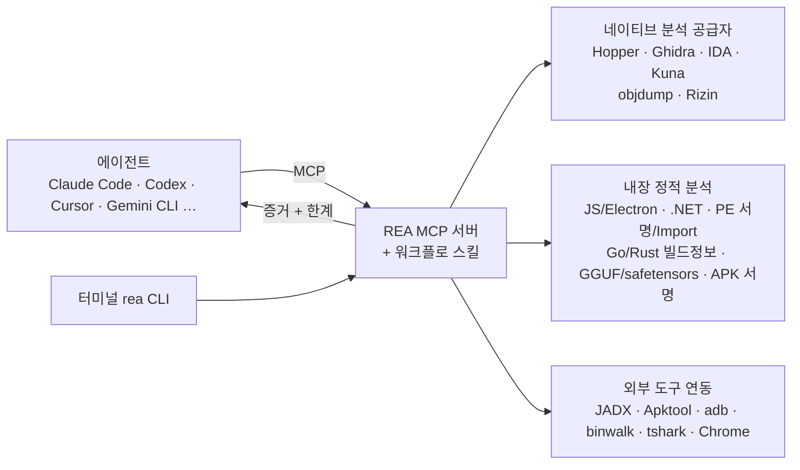

# 2026년 11월 핫 오픈소스 정리 (AI 중심)

> 기준 시각: **2026-11-05**
>
> **조사 방법**
> - ① GitHub Search API 실측: 스타·포크·생성일·라이선스. 2026-08-01 이후 생성되고 스타 500 이상인 저장소는 1,651개였습니다.
> - ② 웹 검색으로 YouTube·Hacker News·Reddit·GeekNews 반응을 수집했습니다.
> - ③ 핵심 저장소 README 원문 확인: REA·leanrea·Strata.
>
> **한계**
> - 이 세션의 네트워크 정책으로 youtube.com·news.hada.io·daily.dev 페이지를 직접 열지 못했습니다. 커뮤니티 반응은 **검색 엔진 요약 기준**입니다(아래 출처 표기).
> - 오픈웨이트 모델 순위는 집계 사이트마다 서로 달라 "확인 필요"로 표기했습니다.

---

## 0. 세 줄 요약

1. **"리버싱 + AI = 모든 앱이 오픈소스"**가 10월 최대 화두입니다.
   - REA(Reverse Engineer Anything)가 **스타 43.1만**으로 1위입니다.
   - AI로 Adobe·MS Office를 Rust로 클린룸 재구현한 ArtCraft 시리즈가 뒤를 이었습니다.
   - 법적 논쟁과 회의론이 동시에 커졌습니다.
2. **에이전트 하네스 전쟁**이 진행 중입니다: OpenClaw 39.4만, DeepSeek Harness 27.3만(8월 출시), Hermes Agent 26.1만. 주변 생태계는 메모리(claude-mem)·멀티에이전트 관리(paperclip)·인터넷 접근(Agent-Reach)입니다.
3. **소비자 GPU 로컬 추론**이 확산 중입니다. MoE 전문가 가중치를 SSD/RAM에서 스트리밍하는 방식(Strata, Edge0)이 대표적이고, 8 GB VRAM PC도 대상권에 들어왔습니다. 반면 **가짜 스타·무료 모델 우회 플러그인·탈옥 플러그인** 같은 위험 신호도 같이 늘었습니다.

---

## 1. 트렌드 지도

| # | 트렌드 | 대표 저장소 (스타, 11-05) | 한 줄 |
|---|---|---|---|
| T1 | **리버싱 에이전트 & AI 클린룸 재구현** | morluto/rea **431k** · storytold/photocraft 77k · wordcraft 17k · craft-anything 12k · HeyPuter/everything 7k · aicodeking/leanrea 4k | 바이너리·Electron·.NET·APK를 에이전트가 직접 분석하고, 상용 앱을 처음부터 다시 만드는 흐름 |
| T2 | **에이전트 하네스 / 런타임** | openclaw/openclaw **394k** · deepseek-ai/deepseek-harness **273k** · NousResearch/hermes-agent **261k** · paperclipai/paperclip 111k · google-research/harness2 23k · omnigent 11k | "모델보다 하네스"가 성능을 좌우한다는 인식. 플러그인·스킬·게이트웨이 경쟁 |
| T3 | **에이전트 메모리·컨텍스트 절약** | DietrichGebert/ponytail 185k · thedotmack/claude-mem 113k · mem0 68k · Trail-Code 11k | 세션 간 기억 유지, 팀 공유 메모리, "덜 쓰는 코드" 스킬 |
| T4 | **에이전트의 눈과 손** | Panniantong/Agent-Reach 109k · browser-use 120k(+jev-ultrafast 24k) · lexmount/moli 23k · google/artemis 17k · vercel-labs/agent-desktop 15k · CopilotKit/OpenBot 10k · Mika 7k | 웹·SNS·안드로이드·데스크톱 조작. 헤드리스 브라우저는 Rust로 재작성되는 추세 |
| T5 | **소비자 하드웨어 로컬 추론** | Niko1221/Strata 40k · deepseek-ai/DeepInfer 25k · kimi-k3-in-c 10k · Edge0 9k · turbo-fieldfare 7k | 대형 MoE를 SSD·RAM 스트리밍으로 소형 GPU·노트북에서 실행 |
| T6 | **스킬 생태계·문서 변환** | microsoft/markitdown 194k · anatomy 25k · firecrawl/anydoc 23k · google/elephant-goldfish-model 12k · unslop 9k | 에이전트용 단일 기능 스킬, 모든 문서를 Markdown으로 변환 |
| T7 | **모델 라우팅·프록시** | yetone/magpie 30k · opencodex 18k | "Codex를 DeepSeek로, Claude Code를 Kimi로". 약관(ToS) 확인 필수 |

### 오픈웨이트 모델 동향 (2차 출처, 확인 필요)
- 집계 사이트들이 거론하는 상위권:
  - Kimi K3: 2.8T MoE, 커스텀 라이선스
  - DeepSeek V4.1 Flash: 10-17 업데이트, MIT
  - Qwen3.8 계열: 27B·Flash-Next 125B-A6B
  - Gemma 4: Apache-2.0
  - GLM-5.3, NVIDIA Nemotron 3.5
- 로컬용 단골 후보: Qwen3.6-27B, GPT-OSS 20B, Gemma 4 12B.
- 사이트마다 순위·출시일·라이선스가 서로 달랐습니다. **도입 전 각 랩의 모델 카드 원문을 확인하세요.**

---

## 2. 커뮤니티·YouTube 반응

| 채널 | 무엇이 화제였나 | 출처 |
|---|---|---|
| **YouTube – Fireship (10-12)** | "Every app on Earth is now open source": 한 개발자가 AI로 Adobe 앱 7종을 Rust로 재작성해 무료 공개(ArtCraft). 조회수 620만 이상으로 보도됨(2차) | ai-tldr, moelueker |
| **YouTube – 한국어** | REA 열풍 검증 영상이 10월 중·하순에 집중됨: "[Deep SLASH] 깃허브 발칵 뒤집은 'REA' 완벽 정리", "소프트웨어는 끝났다는 REA 직접 검증해봤습니다", "REA로 리버스 엔지니어링 실험 2가지", "리버스 엔지니어링 AI, REA 열풍 진짜일까?" | YouTube 검색 |
| **YouTube – 회의론** | "REA is the Most Useless Thing I've Ever Tried" 등 **과장론** 리뷰도 나옴. "무엇이든 복제"는 사실이 아니며, REA는 원본 소스를 복원하지 않음 | YouTube 검색, REA README |
| **Hacker News** | REA 스레드에서 **라이선스(EULA) 위반·소송 위험**을 놓고 논쟁. Sega v. Accolade·Sony v. Connectix(호환 목적 디스어셈블은 공정이용 가능) 판례 인용. 에이전트 보조 리버싱에 대한 판결은 아직 없음 | HN, Scientific American 인터뷰 |
| **학계** | Cornell 법학 교수 James Grimmelmann: *"This is going to pose a crisis for trade secret and copyright law"* (저작권은 코드를 보호하지 알고리즘·아이디어를 보호하지 않음) | Scientific American |
| **Reddit** | 가장 많은 공감을 얻은 우려는 법보다 **문화**였습니다: "풀린 퍼즐을 월 $200 구독에 넘기면 취미 리버서들이 협업할 이유가 사라진다". 일부 사용자는 REA 사용 후 AI 계정이 차단됐다고 주장(미검증) | thegenaimagazine(2차) |
| **GeekNews (10-07)** | "우리가 알던 오픈소스는 죽었다": AI로 기여 생성 비용은 0에 가까워졌지만 리뷰 비용은 그대로라 메인테이너들이 외부 PR을 막는 중. Sindre Sorhus는 10-01에 모든 저장소의 외부 PR을 비활성화 | GeekNews |
| **Hacker News Show HN (10월)** | 오픈소스 상위: Pele(의존성 0 Mermaid→SVG 렌더러), Spotatui(Rust 터미널 Spotify), BetterWispr(맥 무료 받아쓰기), PS2 게임 → WebAssembly 정적 재컴파일 | daily.dev, HN Archives |
| **하네스 비교 글** | Hermes = 에이전트 우선·자기개선 학습 루프·CVE 적음 / OpenClaw = 게이트웨이 우선·메신저 20개 이상·스킬 마켓(5,400개 이상)·Docker 30분 셋업 | The New Stack, Composio 등 |

---

## 3. REA (Reverse Engineer Anything) 집중 분석

> 이 저장소의 [`rea-reverse-engineering-analysis.md`](rea-reverse-engineering-analysis.md)는 Lab 자체의 악성코드 정적 분석 체계를 다룹니다. 이 절의 **오픈소스 REA(morluto/rea)**와는 이름만 같고 별개입니다.

### 3.1 구성



| 항목 | 내용 (README 원문 기준) |
|---|---|
| 정체 | 바이너리·앱·런타임 동작을 아우르는 리버싱용 **MCP 서버 + CLI + 에이전트 스킬** |
| 라이선스 | MIT. IDA·Hopper·JEB 등 상용 도구는 **정식 라이선스 필요**(크랙·키 공유 불가 명시) |
| 설치 | `npx rea-agents setup`: 에이전트를 고르고 변경 사항을 검토·승인하면 MCP 등록과 지침을 설치(기존 설정 백업). 끝나면 에이전트 재시작 |
| 런타임 | Node.js 22.x(≥22.23.4) / 24.x(≥24.22.1) / 26.12.1+ |
| 분석 대상 | 네이티브 바이너리, JS/Electron(ASAR), .NET, Android APK, WASM, 펌웨어, 웹사이트, HAR 캡처, PyInstaller, Unity IL2CPP, GGUF·safetensors 메타데이터 등 30여 종 |
| 컨텍스트 조절 | `REA_MCP_INPUT_SCHEMA_PROFILE=full`, `REA_MCP_OUTPUT_SCHEMA_PROFILE=compact\|off` |
| 데이터 | 분석은 로컬에서 수행. 단, 결과는 에이전트의 모델 제공자 정책을 따름 |
| 공식 배포처 | `github.com/morluto/rea`, `rea.tools`, npm `rea-agents`만 공식. **README를 복제한 가짜 저장소가 트렌딩 직후 등장**했다는 보도가 있음 |

### 3.2 사용 예시

```text
# 에이전트에게 (README 예시)
Understand how search works in the Notes app, show me the evidence, and build a
similar feature for my project.
```

```bash
# 터미널: 추출된 Electron 앱 디렉터리·ASAR 정적 분석 (앱을 실행하지 않음)
npx -y rea-agents@latest analyze-javascript-application /absolute/path/to/app --json

# 상시 설치
npm install --global rea-agents
rea --help
rea update
```

- **공개 사례**:
  - DX-Ball 사운드 팬 계산을 C로 복원했습니다. 원본 x86 대조 3,205케이스를 통과했고 함수 63바이트가 일치합니다.
  - Notion Electron 클립보드 브리지를 추적했습니다.
  - PC-98 DOS 게임의 탄막 각도 계산을 복원했습니다.
- **RL 환경 생성**: 웹앱 세션(HAR)을 에이전트용 도구·환경으로 내보냅니다: `rea environment-build ./session.har ./my-env`.

### 3.3 비용·대안 — leanrea 벤치마크 (상대측 주장, 3회 반복·단일 모델)

| | REA 6.5.0 | leanrea (스킬 1개, 8 KB) |
|---|---|---|
| 에이전트에 추가되는 도구 | 207개 (정의 3.35 MB) | 0개 (Bash 사용) |
| 모든 도구를 로드할 때 컨텍스트 | **400.7k tokens** | 34.5k tokens |
| 4과제 × 3회 결과 | 627 s · $3.36 · 75/75 | **388 s · $2.17 · 74/75** |

- 결론: Claude Code처럼 **도구를 필요할 때만 로드(deferred)**하는 클라이언트에서는 REA를 써도 무리가 없습니다. 모든 도구를 한꺼번에 올리는 클라이언트에서는 컨텍스트 비용이 큽니다.
- 정확도 차이는 작으므로 가벼운 분석에는 leanrea, 깊은 네이티브 분석(Ghidra/IDA 연동)에는 REA를 쓰는 조합이 합리적입니다.

### 3.4 써도 되는 선

- **허용**: 내가 소유하거나 분석 권한이 있는 소프트웨어, 상호운용성, 보존, 연구, 보안 분석(README 면책 조항).
- **주의**: 상용 EULA의 리버싱 금지 조항, 국가별 법, 게임 재컴파일·앱 복제의 저작권 문제. 판례가 아직 없습니다.
- **Lab 관점**: 악성코드 분석에 쓸 때 REA의 **런타임 캡처 기능은 대상을 실제로 실행합니다.** 의심 파일은 정적 분석 기능(.NET·PE·JS)만 쓰고, 그것도 네트워크를 끊은 VM 안에서만 쓰세요(Lab REA 규칙과 동일).

---

## 4. 이번 달 눈여겨볼 12선

| 저장소 | 스타 / 포크 | 무엇 | 왜 지금 | 성숙도 |
|---|---|---|---|---|
| openclaw/openclaw | 394k / 83k | 범용 개인 에이전트 런타임(게이트웨이형) | 스킬 마켓 5,400개 이상, 메신저 연동 | 성숙 |
| deepseek-ai/deepseek-harness | 273k / 33k | "Everything is a Plugin" 에이전트 하네스(`npx @deepseek-ai/dsh web` → 127.0.0.1:3080) | 8-13 출시, 플러그인 생태계 폭발(dsh-desktop·dsh-Go·DS-Bot…) | **개발자 프리뷰**(호환성 깨짐 예고) |
| NousResearch/hermes-agent | 261k / 57k | 자기개선형 에이전트 | 학습 루프, 보안 평판 | 성숙 (Lab 운용 중) |
| paperclipai/paperclip | 111k / 18k | 업무용 멀티에이전트 관리 앱 | 에이전트 여러 개를 "팀"으로 운영 | 성장 |
| thedotmack/claude-mem | 113k / 10k | 모든 에이전트 세션 간 영속 메모리 | 일일 스타 +1.5~1.8k (11월 초 트렌드 리포트) | 성장 |
| Panniantong/Agent-Reach | 109k / 10k | 에이전트에게 X·Reddit·YouTube·GitHub 읽기·검색 능력 | 리서치 에이전트의 표준 부품화 | 성장 |
| google-research/harness2 | 23k / 2k | 구글 리서치 하네스(설명 비공개) | 10-06 공개 | 초기 |
| deepseek-ai/DeepInfer | 25k / 3k | DeepSeek 모델용 대규모 추론 프레임워크 | 10-16 공개 | 초기 |
| Niko1221/Strata | 40k / 4k | Qwen3.8-Flash-Next 등 대형 MoE를 소비자 HW에서 원클릭 실행 | 전문가 가중치 RAM/SSD 스트리밍 | 초기 (0.2.x) |
| lexmount/moli | 23k / 0.6k | AI 에이전트용 Rust 헤드리스 브라우저 | 가볍고 빠름 | 초기 ⚠ 포크/스타 0.028 |
| firecrawl/anydoc | 23k / 1.5k | Office·PDF·EPUB → Markdown (Rust, Node/Python 바인딩) | markitdown 대안 | 성장 |
| storytold/craft-anything | 12k / 2k | "소프트웨어 동작을 이해하고 직접 만들기" 가이드·도구 | ArtCraft 클린룸 재구현 방법론 | 초기 |

---

## 5. ⚠ 위험 신호 — 별이 많아도 거르기

> CMU 연구(ICSE 2026): 30.1만 개 계정으로 1만 8,617개 저장소에 **가짜 스타 약 600만 개**가 찍혔고, AI/LLM 저장소가 비악성 범주 중 최대였습니다. 가짜 스타 효과는 2개월 미만으로 짧습니다.
> 보조 지표(2차 출처): **포크/스타 비율**은 자연 성장 저장소가 0.10~0.24, 조작 의심 저장소는 흔히 0.05 미만입니다. 참고 지표일 뿐 증거는 아닙니다.

| 저장소 | 신호 | 판단 |
|---|---|---|
| Ebony-Vinyl/dsh-our-free-model (61k) | "로그인·API Key 없이 프런티어 모델 무료·무제한" + 포크/스타 **0.027** | **사용 금지**. 타인 키·약관 우회 가능성, 자격 증명·트래픽이 제3자를 거침 |
| HunYiSage/dsh-purge (18k) | 모든 모델 "탈옥" 프롬프트 | 사용 금지. 계정 차단·정책 위반 |
| guillaumemeyer/watermarks-remover (26k) | AI 워터마크 제거 | 출처 표기 의무·플랫폼 정책 충돌 위험 |
| miuuyy/codex-chatgpt-web, 각종 프록시 | ChatGPT 웹 세션을 API처럼 사용 | 약관 위반·세션 토큰 노출 위험 |
| Zagitta/gpu-unlock (17k) | GeForce 텐서 성능 2배를 주장하는 드라이버 수준 패치, **라이선스 없음** | 업무 PC 사용 금지. 검증된 커뮤니티 측정이 나올 때까지 관망 |
| 게임 정적 재컴파일·포팅(totk-pc-recomp, nxnative, AnyPS5 등) | 저작권·DMCA 위험 | 기술 학습용으로 코드 읽기만 |
| REA 사칭 저장소 | README를 복제한 가짜 배포본 | 공식 3곳에서만 받기 |
| `irm … \| iex`, `curl … \| sh` 원라인 설치기 | 스크립트 검토 없이 실행 | 먼저 내려받아 읽은 뒤 실행 (2026-10 Lab 침해 사례의 교훈) |

---

## 6. 우리 Lab에 맞춘 추천 (RTX 4070 Laptop 8 GB / RAM 32 GB, Claude·Codex·Hermes·Paseo 운영 중)

| 우선 | 무엇 | 왜 | 첫 단계 |
|---|---|---|---|
| ★★★ | **leanrea → REA(정적 모드만)** | Lab REA 체계(정적 분석)에 에이전트 보조를 붙임. .NET·PE 서명·Import·Electron ASAR 분석이 지난 사례와 정확히 겹침 | VM 안에서 `npx skills add aicodeking/leanrea -a claude-code -y` 실행 → 무해한 샘플(자작 Electron 앱)로 검증 |
| ★★★ | **markitdown / anydoc** | PDF·PPTX를 MD로 변환하는 작업이 Lab에 많음 | 기존 변환본 1건과 품질·속도 비교 |
| ★★☆ | **Agent-Reach** | Hermes 장기 리서치에 SNS·YouTube 검색 능력 추가 | Hermes `03_playground`에서 읽기 전용 API만 사용 |
| ★★☆ | **claude-mem** vs 기존 ai-daily-log | 세션 간 기억. 기존 일지 체계와 겹치는지 확인 | 1주 병행 후 토큰·회상 정확도 비교 |
| ★★☆ | **Strata** | 8 GB VRAM + 32 GB RAM에서 Qwen3.8-Flash-Next 2-bit 최대 30 tok/s라는 **사용자 보고**(미검증). DeepSeek 4.1 세트는 디스크 245 GB 이상 필요 | 설치 스크립트를 내려받아 검토한 뒤 Qwen 소형 세트로 측정 |
| ★☆☆ | **paperclip** | Paseo·Agent Desk와 역할이 겹침. "팀 단위 에이전트 관리"가 필요할 때 | 관망 |
| ☆ | **DeepSeek Harness** | 생태계는 뜨겁지만 개발자 프리뷰라 호환성이 깨질 수 있음. 위험 플러그인이 섞여 있음 | 공식 플러그인만으로 PoC, 서드파티 플러그인 금지 |
| ✕ | gpu-unlock, 무료 모델·탈옥 플러그인 | 5장 참조 | — |

도입 절차는 [`ai-opensource-inventory.md` 시나리오 A](ai-opensource-inventory.md#시나리오-a--외부-ai-오픈소스스킬mcp-도입-평가)를 따릅니다: bare clone 정적 분석 → 토큰·권한 측정 → 4개 이하 선별 → 하나씩 검증.

---

## 부록 A. 실측 데이터 (GitHub Search API, 2026-11-05)

| 저장소 | 스타 | 포크 | 포크/스타 | 생성일 | 라이선스 |
|---|---:|---:|---:|---|---|
| morluto/rea | 431,189 | 107,166 | 0.249 | 2026-04-14 | MIT |
| openclaw/openclaw | 393,924 | 82,786 | 0.210 | 2025-11-24 | MIT |
| deepseek-ai/deepseek-harness | 272,695 | 33,214 | 0.122 | 2026-08-13 | MIT |
| NousResearch/hermes-agent | 260,582 | 57,464 | 0.221 | 2025-07-22 | MIT |
| microsoft/markitdown | 193,920 | 14,564 | 0.075 | 2024-11-13 | MIT |
| ollama/ollama | 185,942 | 18,892 | 0.102 | 2023-06-26 | MIT |
| DietrichGebert/ponytail | 184,605 | 10,186 | 0.055 | 2026-06-12 | MIT |
| ggml-org/llama.cpp | 133,393 | 25,160 | 0.189 | 2023-03-10 | MIT |
| openai/codex | 133,209 | 21,102 | 0.158 | 2025-04-13 | Apache-2.0 |
| browser-use/browser-use | 120,052 | 13,386 | 0.112 | 2024-10-31 | MIT |
| thedotmack/claude-mem | 112,929 | 9,807 | 0.087 | 2025-08-31 | Apache-2.0 |
| paperclipai/paperclip | 111,144 | 18,407 | 0.166 | 2026-03-02 | MIT |
| Panniantong/Agent-Reach | 108,855 | 9,723 | 0.089 | 2026-02-24 | MIT |
| google-gemini/gemini-cli | 108,733 | 14,918 | 0.137 | 2025-04-17 | Apache-2.0 |
| NationalSecurityAgency/ghidra | 97,874 | 11,069 | 0.113 | 2019-03-01 | Apache-2.0 |
| vllm-project/vllm | 96,346 | 24,415 | 0.253 | 2023-02-09 | Apache-2.0 |
| storytold/photocraft | 76,947 | 13,635 | 0.177 | 2026-09-30 | Apache-2.0 |
| mem0ai/mem0 | 68,421 | 8,120 | 0.119 | 2023-06-20 | Apache-2.0 |
| Ebony-Vinyl/dsh-our-free-model ⚠ | 60,880 | 1,649 | **0.027** | 2026-09-24 | MIT |
| karpathy/nanochat | 60,265 | 8,442 | 0.140 | 2025-10-13 | MIT |
| Niko1221/Strata | 40,017 | 4,366 | 0.109 | 2026-09-24 | MIT |
| yetone/magpie | 29,822 | 2,571 | 0.086 | 2026-09-23 | MIT |
| deepseek-ai/DeepInfer | 25,388 | 3,100 | 0.122 | 2026-10-16 | Apache-2.0 |
| browser-use/jev-ultrafast | 24,181 | 1,857 | 0.077 | 2026-09-16 | MIT |
| firecrawl/anydoc | 23,353 | 1,513 | 0.065 | 2026-08-03 | MIT |
| getpaseo/paseo | 23,100 | 2,826 | 0.122 | 2025-10-13 | (미표기) |
| google-research/harness2 | 22,680 | 2,258 | 0.100 | 2026-10-06 | Apache-2.0 |
| lexmount/moli ⚠ | 22,613 | 626 | **0.028** | 2026-08-10 | Apache-2.0 |
| openai/math | 17,336 | 1,957 | 0.113 | 2026-10-06 | Apache-2.0 |
| Zagitta/gpu-unlock ⚠ | 16,666 | 1,663 | 0.100 | 2026-10-18 | (없음) |
| google/artemis | 16,596 | 1,827 | 0.110 | 2026-08-13 | Apache-2.0 |
| vercel-labs/agent-desktop | 15,305 | 1,066 | 0.070 | 2026-02-19 | Apache-2.0 |
| mrexodia/ida-pro-mcp | 13,364 | 1,629 | 0.122 | 2025-03-25 | MIT |
| storytold/craft-anything | 12,132 | 2,026 | 0.167 | 2026-10-31 | Apache-2.0 |
| omnigent-ai/omnigent | 11,218 | 1,850 | 0.165 | 2026-06-11 | Apache-2.0 |
| CopilotKit/OpenBot | 10,158 | 1,253 | 0.123 | 2026-08-17 | MIT |
| Edge0-AI/Edge0 | 9,039 | 1,394 | 0.154 | 2026-09-08 | Apache-2.0 |
| HeyPuter/everything | 7,148 | 743 | 0.104 | 2026-10-13 | MIT |
| bethington/ghidra-mcp | 6,119 | 382 | 0.062 | 2025-08-30 | Apache-2.0 |
| aicodeking/leanrea | 4,001 | 610 | 0.152 | 2026-10-17 | MIT |

재현 명령:
```bash
gh api -X GET search/repositories -f q='created:>=2026-08-01 stars:>500' -f sort=stars -f per_page=60 \
  --jq '.items[] | [.stargazers_count, .forks_count, .full_name, .created_at[:10], (.license.spdx_id // "-")] | @tsv'
```

---

## 부록 B. 출처

**GitHub·README (원문 확인)**
- [morluto/rea](https://github.com/morluto/rea) · [aicodeking/leanrea](https://github.com/aicodeking/leanrea) · [Niko1221/Strata](https://github.com/Niko1221/Strata) · [deepseek-ai/deepseek-harness](https://github.com/deepseek-ai/deepseek-harness)

**트렌드 리포트·기사 (검색 요약 기준)**
- [AI Open Source Trends 2026-11-04 (agents-radar)](https://github.com/yaojiejia/agents-radar/issues/412)
- [DeepSeek Harness Review (DeepInfra)](https://deepinfra.com/blog/deepseek-harness-review) · [Getting Started with DeepSeek Harness (codepick)](https://codepick.dev/en/guides/deepseek-harness-intro/)
- [An exclusive conversation with the developer of REA (Scientific American)](https://www.scientificamerican.com/article/an-exclusive-conversation-with-the-developer-of-rea-the-viral-ai-reverse-engineering-tool/)
- [REA: How to Use, Fake Stars?, Legal (The GenAI Magazine)](https://thegenaimagazine.com/rea-reverse-engineer-anything-github-what-it-does-legal-line)
- [REA: What the MCP Server Does and Where the Line Is (Developers Digest)](https://www.developersdigest.tech/blog/reverse-engineer-anything-rea-mcp-agents-guide-2026)
- [Reverse Engineer Anything: What It Is and Why It Exploded](https://moelueker.com/blog/reverse-engineer-anything)
- [Photoshop and Word Rebuilt in Rust (innFactory)](https://innfactory.ai/en/blog/ai-rebuilt-photoshop-word-reverse-engineering/)
- [Six Million (Suspected) Fake Stars in GitHub (Hao He, CMU)](https://hehao98.github.io/publication/2026-github-star)
- [OpenClaw vs. Hermes Agent (The New Stack)](https://thenewstack.io/persistent-ai-agents-compared/) · [OpenClaw vs Hermes Agent (Composio)](https://composio.dev/content/openclaw-vs-hermes-agent)
- [Best Local LLMs November 2026 (BenchLM)](https://benchlm.ai/best/local-llm) · [The Best Open Source LLMs October 2026 (Morph)](https://www.morphllm.com/best-open-source-llm)
- [What makes Strata so good for local AI on small GPUs?](https://www.llamabuilds.ai/guides/how-strata-revolutionized-local-ai-inference)

**YouTube**
- [Fireship – Every app on Earth is now open source (10-12, 요약 페이지)](https://ai-tldr.dev/releases/fireship-every-app-open-source-oct12/)
- [[Deep SLASH] 깃허브 발칵 뒤집은 'REA' 완벽 정리](https://www.youtube.com/watch?v=3NFwU6dAUws) · [소프트웨어는 끝났다는 REA 직접 검증해봤습니다](https://www.youtube.com/watch?v=rwCDPZP_Zk4) · [REA로 리버스 엔지니어링 실험 2가지](https://www.youtube.com/watch?v=-jAI9qowzE8) · [리버스 엔지니어링 AI, REA 열풍 진짜일까?](https://www.youtube.com/watch?v=DJfxnwLpQVM)
- [REA is the Most Useless Thing I've Ever Tried](https://www.youtube.com/watch?v=n9QWe9tyYhE) · [I Tested The Viral Github Repo That Reverse Engineers Anything](https://www.youtube.com/watch?v=yBrJzwKtjX8)
- [이번 주 개발자라면 봐야 할 오픈소스 Top 10 +@](https://www.youtube.com/watch?v=MbpCiTNGXxM)

**커뮤니티**
- [Hacker News – REA](https://news.ycombinator.com/item?id=50028275) · [Best Hacker News posts – October 2026 (daily.dev)](https://daily.dev/sources/hn/best-of/2026/10) · [HN Archives Show HN 2026](https://hnarchives.com/showHN?year=2026)
- [GeekNews – 우리가 알던 오픈소스는 죽었다](https://news.hada.io/topic?id=34900)
