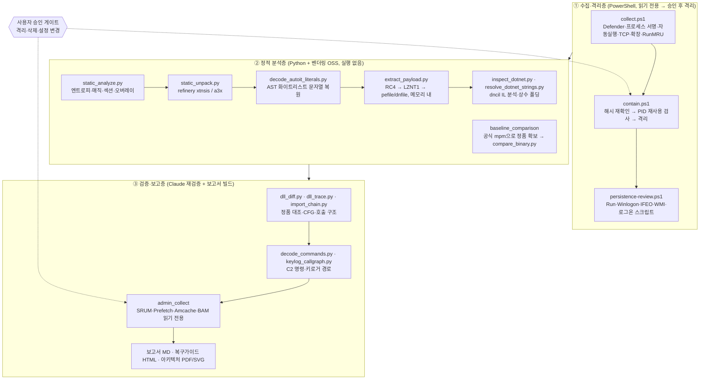

# REA — Reverse Engineering Analysis (정적 리버싱 분석) 구성과 활용

> 기준일: 2026-11-05.
> 원본 위치:
> - `D:\VSCode_Workspace\90.diagnostics\2026-10-22_account_compromise` (Codex)
> - `D:\MYDrive\19_AI_LAB\pc-compromise-analysis-261022` (Claude)
> - `02.AI_laboratory\10_Codex_Lab_V02\2026-10\*_Codex` 3개 폴더
>
> 이 문서는 위 원본의 Drive 미러를 **읽기 전용으로** 조사해 정리했습니다. 원본에 "REA"라는 이름의 폴더는 없습니다. 위 위치에 흩어져 있는 분석 체계를 이 문서에서 **REA**로 묶어 부릅니다.
>
> 공개 저장소이므로 다음은 싣지 않았습니다: 악성 샘플·복원 페이로드, 개인 계정·금융·토큰 정보, 사용자 경로.

---

## 1. REA란 — 한 줄 정의

**의심 파일을 한 번도 실행하지 않고**, 바이트와 구조만 읽어 다음을 밝히는 분석 체계입니다.
- 무엇이: 정체
- 언제: 실행 시점
- 어떻게: 지속성·주입
- 무엇을 노리는지: 수집 대상

여기에 Windows 실행 기록 포렌식과 **AI 에이전트 2중 검증(Codex 1차 → Claude 재검증)**을 결합합니다.

| 원칙 | 구체 규칙 (원본 문구) |
|---|---|
| 실행 금지 | "CLR 로딩, DLL 호출, 분석 코드의 에뮬레이션, 격리 해제, 샘플 외부 업로드, 공격자 주소 접속을 하지 않았다." |
| 재생성 금지 | 백신이 추출 PE를 잡은 뒤 "그 PE를 다시 파일로 만들지 않았고, 원본에서 계산한 메모리 바이트를 파서 입력으로만 사용했다." |
| 백신 보호 유지 | "백신 실시간 보호/변조 방지를 끄거나 예외를 추가하지 않는다." |
| 격리 ≠ 확장자 | "`.disabled` 확장자는 보안 격리 기능이 아니다. 코드·샘플은 일반 프로젝트 백업이나 복원 대상에 섞지 않는다." |
| 해시 검증 | 이동·격리 전후 SHA-256 비교. 해시가 바뀌면 중단합니다(`throw "Hash changed"`). |
| HITL 승인 | 격리·DLL 비활성화·설정 변경은 사용자 승인 후. 자동 승인 검사가 DLL 이름 변경을 막았고, 명시 승인을 받은 뒤에 진행했습니다. |
| 비밀값 최소 수집 | 레지스트리 값 이름이 `Password\|Secret\|Token\|Key\|Auth\|Credential`이면 버립니다. IL 덤프의 webhook·토큰 문자열은 가립니다. |
| 증거 수준 분리 | "코드상 가능한 것"과 "실제 쓰인 것"을 구분합니다("높음·직접 증거" / "보류"). |

---

## 2. 구성 — 3층 아키텍처



### 2.1 OSS 도구 스택 (`analysis_tools/`)

| 패키지 | Lab 설치 버전 | 역할 | REA에서 실제로 한 일 |
|---|---|---|---|
| **Binary Refinery** | dist-info 0.3.36 + git 소스(`refinery_source/`, sys.path 최우선) | 파이프라인형 악성코드 트리아지 (`bin/`에 유닛 실행기 약 150개) | `xtnsis`로 NSIS 설치기 스크립트 추출, `a3x`로 AutoIt(EA06) 디컴파일, `lznt1` 압축 해제 |
| **pefile** | 2024.8.26 | PE 헤더·섹션·Import/Export·`.pdata`·Load Config | CFG 포인터·GuardFlags 비교, 섹션별 diff |
| **capstone** | 5.0.9 | x86/x64 역어셈블러 | 덮어쓴 `.text` 61개 함수·패치 바이트 해석, 복호화 스텁 정적 해석 |
| **dnfile** | 0.18.0 | .NET 메타데이터·UserString·리소스·ImplMap | 페이로드 P/Invoke·필드·문자열표 추출 |
| **dncil** | 1.0.2 | CIL 메서드 본문 디코더 | 명령 분기 IL·키로거 호출 그래프 |
| **pycryptodomex** | 3.24.1 | 암호 프리미티브 (`Cryptodome.Cipher.ARC4`) | RC4 복호화 단계 |
| msgpack · colorama · defusedxml · pure_magic_rs | — | Binary Refinery 의존성 | — |
| dissect.esedb · regipy | 별도 pylib | ESE DB(SRUM)·레지스트리 하이브(Amcache) 파서 | 관리자 아티팩트 파싱 |
| reportlab | — | PDF 생성 | 6쪽 아키텍처 보고서 |

**설치 방식 (원본 관찰)**
- 각 dist-info에 `INSTALLER=pip`가 있고 `direct_url.json`은 없습니다. 즉 PyPI에서 받은 것입니다.
- 패키지가 한 폴더에 평평하게 있고 옆에 `bin/`이 있습니다. venv가 아니라 **`pip install --target analysis_tools`로 벤더링**한 구조입니다.
- 스크립트는 `sys.path.insert(0, ROOT/'analysis_tools')`로 툴을 불러옵니다.
- requirements 파일과 설치 로그가 없습니다. 재현성을 위해 이 저장소의 [`rea/requirements-rea.txt`](../rea/requirements-rea.txt)로 버전을 고정했습니다.
  - 2026-11-05 Python 3.13에서 설치를 검증했습니다.
  - 확인한 유닛: `a3x`·`xtnsis`·`lznt1`·`rc4`·`carve-pe`·`dnstr`·`pemeta`.
  - rc4·lznt1 왕복 변환과 capstone 역어셈블이 정상 동작했습니다.

### 2.2 케이스 폴더 구조 (원본 관례 정규화)

```text
90.diagnostics\YYYY-MM-DD_<case>\
├─ README.md                ← (권장) 결론 / 범위·한계 / 근거 / 다음 조치  ※ 원본엔 없음
├─ case.json
├─ suspect_hashes.json      → containment.json → quarantine_hashes_after_analysis.json
├─ collect\                 collect.ps1 결과 *.json
├─ quarantine\              NN_<원래이름>.quarantined   (실행·복원 금지)
├─ static_analysis\
│   ├─ unpacked_nsis\       record_NNN.txt + manifest.json
│   └─ unpacked_autoit\     .txt(텍스트) / .bin.disabled(그 외) + manifest.json
├─ baseline_comparison\     공식 경로 정품 + *_comparison.json + provenance.json
├─ persistence_review\
├─ mitm_review\
├─ architecture_review\     PDF·SVG·draw.io·diagram_model.json·build_checks.json
├─ admin_collect\           run_admin_collect.cmd · collect_admin.ps1 · parse_artifacts.py
├─ analysis_tools\          pip --target 벤더링
└─ evidence\scripts\        분석 스크립트 (docstring: "never loads or executes sample code")
```

- 모든 출력 JSON에는 `limitations` 배열을 둡니다.
- 상태 추적 파일: `followup_status.json`, `followup_events.jsonl`, `remediation_audit.jsonl`, `automation_handoff.json`.
- 이 구조는 [`rea/new_case.py`](../rea/new_case.py)로 한 번에 만들 수 있습니다.

---

## 3. 단계별 절차 (실제 실행 순서)

| 단계 | 담당 | 스크립트·도구 | 입력 → 출력 | 게이트 |
|---|---|---|---|---|
| 0. 경보 | 사용자 | 백신 탐지(`Injection/MDP.Hollowing`) | — | — |
| 1. 읽기 전용 수집 | Codex | `collect.ps1`, `inventory_c.py`(메타데이터만, reparse·클라우드 항목 거부) | PC 상태 → `*.json`, `new_files.csv` | 없음 (읽기 전용) |
| 2. 격리 | Codex | `contain.ps1` | `suspect_hashes.json` → `containment.json` (`Verified`, `OriginalExists`) | **승인 필요**. 해시 변경 시 중단, PID 재사용 검사 |
| 3. 지속성 점검·제거 | Codex | `persistence-review.ps1` | 레지스트리·WMI·Startup → 백업 후 값 제거 | **승인 필요** |
| 4. 정적 구조 분석 | Codex | `static_analyze.py` | 샘플 → `file_structure.json` | — |
| 5. 언패킹 | Codex | `static_unpack.py nsis\|autoit` (refinery, 2000레코드·512MB 상한) | 설치기·스크립트 → `.txt` / `.bin.disabled` + `manifest.json` | — |
| 6. 디코딩·복호화 | Codex | `decode_autoit_literals.py` → `extract_payload.py` | AutoIt 리터럴 → RC4 → LZNT1 → PE 파싱 (**메모리 내, 파일 미생성**) | — |
| 7. .NET 분석 | Codex | `inspect_dotnet.py`, `resolve_dotnet_strings.py`, `recover_resource_strings.py` | 페이로드 → `payload_il.json`, `resolved_dotnet_strings.json` | 토큰 문자열 가림 |
| 8. 정품 대조 | Codex | 공식 `mpm`(서명 Valid 기록) → `extract_official_references.py` → `compare_binary.py` | 정품·의심 DLL → `*_comparison.json` | 출처 증명(`provenance.json`) |
| 9. 재검증·심화 | **Claude** | `codex_dump.py`(Codex 로그 → 텍스트), `dll_diff.py`, `dll_trace.py`, `import_chain.py`, `decode_commands.py`, `keylog_callgraph.py`, `reg_lastwrite.py` | Codex 산출물 → 재현·반박·추가 발견 | — |
| 10. 관리자 아티팩트 | Claude | `run_admin_collect.cmd` → `collect_admin.ps1`(`esentutl /y /vss`) → `parse_artifacts.py` | SRUM·Amcache·Prefetch·BAM·4688/4624 → `*_findings.json` | **UAC 1회**, 설정 변경 없음, 로컬 비동기화 폴더 |
| 11. 보고·복구 | Claude/Codex | `build_architecture_report.py`(사전조건 assert 후 렌더) | 보고서 MD·복구가이드 HTML·PDF | 레이아웃 경고 시 중단 |
| 12. 재발 방지 | 사용자 | `harden_logging_user_run.ps1` | PS·Security 로그 256MB, 4688+명령줄 감사, Sysmon | 재설치 후 실행, 되돌리기 명령 포함 |

---

## 4. 활용 예시 — 사례 연구 (2026-10, 변조 설치기 → 정보탈취형 악성코드)

### 4.1 밝혀낸 감염 체인

```mermaid
flowchart LR
  A["비공식 MATLAB 설치기<br/>(NSIS, 개인 명의 코드서명)"] -->|정품 설치 후 CDN에서 DLL 덮어쓰기| B["활성화 DLL<br/>1단계 로더"]
  B -->|활성화 단계에서 실행| C["%APPDATA%<br/>AutoIt3.exe + app.asar(AutoIt EA06)"]
  B -->|등록| P["HKCU\Environment<br/>UserInitMprLogonScript<br/>(T1037.001)"]
  P -->|매 로그온| C
  C -->|RegAsm.exe 할로잉<br/>(T1055.012)| D["메모리 상주 .NET 본체<br/>RedLine 계열 탈취 + 원격제어"]
  D -->|BSC 공개 RPC로 C2 조회<br/>(T1102.001, 추정)| E["C2 :443"]
```

### 4.2 기법 → 발견 매핑 (REA를 쓰면 무엇을 알 수 있나)

| REA 기법 | 도구 | 발견 |
|---|---|---|
| **정품 대조 바이트 diff** | 공식 `mpm` + pefile/capstone (`compare_binary.py`, `dll_diff.py`) | 활성화 DLL: `.reloc`에 488,960 B 블롭 추가(엔트로피 7.63), `.text` 61개 함수 12,729 B 덮어씀.<br/>다른 DLL 1개: 4곳 8바이트 패치(`xor eax,eax; ret`, `je→jmp`)만 있음 → **"변조 ≠ 악성"** 판정.<br/>`RegAsm.exe`: 정품과 SHA-256 동일 → **"파일은 정상, 메모리가 악성"** |
| **PE Load Config 검사** | pefile (`dll_trace.py`) | CFG 함수 포인터 2개가 0, GuardFlags 0x100 → 0 (보호 해제) |
| **동적 API 해석 탐지** | capstone + IAT | 변경 코드가 쓰는 API가 `GetModuleHandleW`·`GetProcAddress`뿐 → 런타임 API 해석 |
| **Import 체인 역추적** | pefile (`import_chain.py`) | 변조 DLL을 정적 import하는 모듈은 5개뿐 → **실행 시점 = 활성화·애드온 설치 단계**("MATLAB만 안 켜면 안전"은 오판) |
| **NSIS 스크립트 추출** | refinery `xtnsis` | 설치기가 CDN에서 DLL 4개·라이선스 파일을 받아 덮어쓰는 행 특정 |
| **AutoIt 디컴파일** | refinery `a3x` | `app.asar`는 Electron이 아니라 AutoIt 컴파일 스크립트(18,580줄 난독화). 샌드박스 회피 검사 포함(T1497) |
| **안전한 문자열 복원** | AST 화이트리스트 평가기 | "AutoIt을 해석하지 않고" 4가지 순수 문자열 변환만 재구현 → API 이름·암호문 복원 |
| **메모리 내 복호화 파이프라인** | pycryptodomex RC4 → refinery LZNT1 | 421,376 B x64 .NET 본체 복원. 파일로 쓰지 않음 |
| **.NET IL 분석** | dnfile + dncil | C2 명령 31개 복원. 키로거(`WH_KEYBOARD_LL`, T1056.001)는 `ReceiveInitOtherModules` 명령으로 켜짐. 쿠키·토큰 탈취(T1539, T1555.003) |
| **Windows 실행 기록 타임라인** | UserAssist·PCA·이벤트 로그·파일 시각 | 로그온 8초 뒤 자동 재실행 실측, 상주 가능 구간 최대 약 81시간 |
| **추가 설치물 점검** | 감염 기간 새 실행 파일 8,154개 후보 분류 | 서명 없는 53개 모두 출처 확인. 디스크 키로그 파일 0건 |

### 4.3 판정 결과와 조치 판단

`"그 DLL만 막으면 되나?" → 아니요`

| 층 | DLL 차단으로 해결되나 |
|---|---|
| ① 배포기 | 아니요. 다시 실행하면 변조 DLL을 또 받아 옵니다 |
| ② 로더 DLL | 이 층만 해결됩니다 |
| ③ 상주 악성코드 | 아니요. **DLL과 무관하게 로그온마다** 돌았습니다 |
| ④ 원격 조종 결과물 | 아니요. 별도 점검이 필요합니다 |
| ⑤ 이미 빠져나간 것 | 아니요. 계정·토큰 교체만 효과가 있습니다 |
| ⑥ C2 | 아니요. 블록체인 조회형이라 IP 하나를 차단해서는 부족합니다 |

**결론**: 계정 조치를 먼저 합니다(안전한 다른 기기에서). 다음으로 증거를 보존(선택)하고, 자료만 백업한 뒤 **C: 클린 재설치**를 권장합니다.

### 4.4 IOC (방어 공유용)

| 종류 | 값 |
|---|---|
| 설치기 (R2026b 위장) | SHA256 `AD3A869E98C7752DF7A9942A8D5786BE52BA5B0478609BF7F319C631D60553A1` |
| 설치기 (R2025b 위장) | SHA256 `8CC80887670247983028E3AADAED6125810FB3CD0AEB837C4DCE9787AD372812` |
| 변조 활성화 DLL | SHA256 `E8972572B5204DCDAFC940E2052C53FA3F24B4991B95C9B888860720C808B196` |
| app.asar (AutoIt) | `E42F5A1AAEC42B9D612CDD3BC779907AAF7DC46CA0347E8A67CDAAB19E044FAB`, `377FC2CD0F5C953FFEF6A0DD9A450597B9356B6208E3D6794BDBAB8EF843CCB4` |
| .NET 본체 | SHA256 `CEBE1B9858FC19B35586D5D40343C99F220EB364DCE585CE7D9AB05ED8AF2D48` |
| 코드서명 인증서 | Certum Code Signing 2021 CA, 시리얼 `24EC5DC000991F2339D449FD3976A8F7`, 지문 `52401AF46B52365426E7125915FD2399809B5810` |
| 네트워크 | `MATLAB[.]b-cdn[.]net`, C2 `62[.]238[.]87[.]60:443`, BSC 공개 RPC 악용 |
| 레지스트리 | `HKCU\Environment\UserInitMprLogonScript` |

---

## 5. 재사용 플레이북 — 다음 의심 파일이 생기면

### 5.1 준비 (5분)

```powershell
# 1) 케이스 폴더 생성 (덮어쓰기 없음)
python rea\new_case.py D:\VSCode_Workspace\90.diagnostics <slug> --agent Codex

# 2) 툴체인 벤더링 (버전 고정)
python -m pip install --target D:\VSCode_Workspace\90.diagnostics\<date>_<slug>\analysis_tools -r rea\requirements-rea.txt

# 3) 기준 해시 매니페스트 (이동·격리 전)
python rea\hash_manifest.py create <case> -o <case>\manifest_before.json --exclude "analysis_tools/*"
```

### 5.2 Binary Refinery 파이프라인 예시 (실행 아님, 바이트 변환만)

```bat
:: cmd.exe
set PYTHONPATH=<case>\analysis_tools
set PATH=<case>\analysis_tools\bin;%PATH%

emit <case>\quarantine\01_setup.exe.quarantined | xtnsis [| dump <case>\static_analysis\unpacked_nsis\{path} ]
emit <case>\quarantine\05_app.asar.quarantined  | a3x    [| dump <case>\static_analysis\unpacked_autoit\{path} ]
emit blob.bin | rc4 h:<key-hex> | lznt1 | pemeta        # 메모리 파이프라인으로 PE 메타만 확인
```

- 프레임 문법(`[| … ]`)과 `h:` 키 핸들러는 2026-11-05 샌드박스에서 무해한 데이터로 동작을 확인했습니다.
- Windows PowerShell 5.1은 네이티브 명령 사이의 바이너리 파이프를 텍스트로 바꿔 깨뜨립니다. **cmd.exe**(또는 PowerShell 7.4 이상)에서 실행하세요.
- 추출물 중 텍스트만 `.txt`로 남깁니다. 바이너리는 `.bin.disabled`로 두거나, 아예 파일로 만들지 않습니다(Lab 규칙).
- 백신이 추출물을 잡으면 **예외를 추가하지 않습니다.** 원본에서 메모리로만 재계산합니다.

### 5.3 정품 대조 (가장 효율이 높은 단계)

1. 의심 파일과 **같은 빌드**의 정품을 공식 경로에서 받습니다. 서명이 Valid인지, 출처 URL·SHA-256을 `provenance.json`에 기록합니다.
2. 섹션 단위로 diff를 냅니다. 바뀐 RVA → RUNTIME_FUNCTION → 호출자를 매핑합니다.
3. 판정 기준:
   - 소수 바이트 패치 + 추가 코드 없음 → 변조지만 비악성
   - 섹션 확장 + 고엔트로피 블롭 + CFG 해제 + 동적 API 해석 → 로더
   - 정품과 해시가 같은데 의심 행위가 있음 → **메모리 주입 호스트**

### 5.4 에이전트 분업 프롬프트 (실사용 패턴)

| 단계 | 에이전트 | 지시 예 |
|---|---|---|
| 1차 | Codex | "읽기 전용으로 수집하고, 의심 파일 SHA-256을 `suspect_hashes.json`에 기록해. 격리·삭제는 승인 요청 후에만." |
| 재검증 | Claude | "Codex 세션 로그(`codex_dump.py`로 변환)와 산출물을 읽고, 정품 대조로 각 판정을 재현하거나 반박해. 확인 못 한 것은 '한계'로 분리해." |
| 보고 | Claude | "결론 → 파일별 판정 → 실행 시점 → 시간순 → 노출 범위 → 조치 → 한계 → IOC 순으로 써. 추정은 추정으로 표기." |

### 5.5 마감 체크리스트

- [ ] `hash_manifest.py verify`: 이동·격리 전후가 일치하는가
- [ ] 의심 프로세스·C2 연결·자동실행 0건을 실측했는가(`capture_static_analysis_status.ps1` 패턴)
- [ ] 관리자 아티팩트(SRUM·Prefetch·Amcache)를 **재설치·정리 전에** 수집했는가
- [ ] 백신 전체 검사가 **완료 이벤트(1001)**까지 확인됐는가
- [ ] 격리본·추출물을 일반 백업과 분리했는가, 사건 종료 후 폴더째 삭제했는가
- [ ] 노출된 토큰·키를 전부 폐기·재발급했는가

---

## 6. 한계와 개선 제안

| 관찰된 한계 | 영향 | 개선 |
|---|---|---|
| 분석 폴더에 README·workflow·`verification_log.md`가 없음 (Lab 다른 폴더 규칙과 불일치) | 단계별 근거 추적이 보고서에만 의존 | `new_case.py`가 만드는 README 템플릿 사용 |
| `analysis_tools` 버전 고정 파일 없음, PyPI 0.3.36 + git 소스 혼용 | 재현 불가, 유닛 동작 차이 | `requirements-rea.txt`(binary-refinery 0.11.3 고정) |
| 정품 기준 DLL 중 하나의 출처가 기록되지 않음 | 대조 결과의 증거력 저하 | `provenance.json`을 필수 산출물로 |
| 관리자 아티팩트를 수집하기 전에 격리본·추출물을 삭제 | 송신량(SRUM)·호출 주체(Prefetch) 미확정, 추가 정밀 분석 불가 | 마감 체크리스트 3번을 "삭제 전 필수"로 |
| 분석을 감염 PC에서 직접 수행 | 분석 중 노출 위험 | 격리 VM(네트워크 차단)으로 샘플 사본을 옮겨 분석, 호스트에는 해시만 |
| PowerShell 로그 15 MB가 AI 도구 사용량으로 하루 안에 밀림 | 감염 기간 명령 기록 소실 | `harden_logging_user_run.ps1` + Sysmon 상시 적용 |

---

## 7. 이 저장소의 REA 도구

| 파일 | 용도 | 검증 |
|---|---|---|
| [`rea/requirements-rea.txt`](../rea/requirements-rea.txt) | 정적 분석 툴체인 버전 고정 (`pip --target`) | 2026-11-05 Python 3.13 설치·유닛 동작 확인 |
| [`rea/new_case.py`](../rea/new_case.py) | 케이스 폴더 골격 + README·case.json 템플릿 생성 (덮어쓰기 없음) | 재실행 시 `created: []` 확인 |
| [`rea/hash_manifest.py`](../rea/hash_manifest.py) | 읽기 전용 SHA-256 매니페스트 `create / verify / diff` (심볼릭 링크 미추적, 불일치 시 exit 1) | 변경·삭제 탐지, 링크 제외 확인 |
